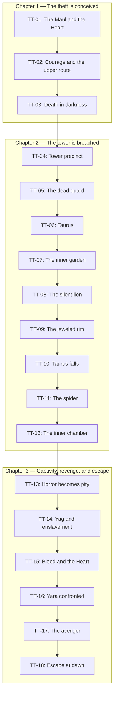

# *The Tower of the Elephant* Adaptation Map

## Purpose and scope

This map divides the immutable 329-line source into a stable analytical spine.
It records what the source directly establishes, then identifies where a
gamebook adaptation may transfer agency, vary method or consequence, or end in
a declared counterfactual. It does not define playable passages.

The catalogue anchors every node to
[`source.md`](../source.md), SHA-256
`416115fed82458a855d2c2c7f37f29c3b4c8b2747618ef18bcbed2d821d0df1f`.
The graph records causal and chronological order only. It assigns no edge
weights, route frequencies, or balance statistics.

## Legend

- **Invariant / canonical function** records an event, revelation,
  relationship, image, or supporting cause that the adaptation must preserve.
- **Decision seam** records a source moment where assessment, choice, trust,
  inquiry, risk, or tactics can credibly pass to the reader.
- **Elastic interval** records a method, route detail, resource cost,
  discovery, or consequence that may vary while preserving the work.
- **Counterfactual boundary** records a departure that should end the attempt
  or explicitly transform it into a non-canonical adaptation.
- **Hazard / information** records a danger or a change in what Conan or the
  reader can know.
- **Relationship change** records a source-backed change between characters.
- An em dash means that the source supplies no useful evidence for that
  classification in the node.

The catalogue entries before each semicolon describe source observation.
Phrases such as “may vary,” “can become,” “could consume,” and “boundary”
state adaptation inference. `TT-12` crosses the chapter break at lines 241-243
and is grouped with Chapter 2 because its action begins at line 234.

## Canonical source graph

## Node catalogue

| ID | Lines | Opening anchor | Closing anchor | Scene | Invariant or supporting canonical function | Natural decision seam | Elastic method, route, or consequence | Counterfactual boundary | Hazard or information transition | Relationship change |
| --- | ---: | --- | --- | --- | --- | --- | --- | --- | --- | --- |
| `TT-01` | 7-25 | `TORCHES flared murkily` | `secret of his magic` | The Maul, Conan, and the first account of the Heart | Establishes Conan as a young, armed outsider and identifies Yara, the tower, and the Heart | How Conan seeks and tests the Kothian's information | Source and quality of preliminary lore may vary | — | The violent Maul frames theft; Conan learns that the Heart is the source of Yara's magic | An outsider gains a wary informant and an audience |
| `TT-02` | 27-49 | `The barbarian digested` | `desire be coupled with courage` | Conan proposes the upper route and is mocked | Establishes the theft motive, Conan's courage, and the upper-route idea | Whether and how Conan acts on the lore and answers the mockery | Preparation, timing, and route details may vary | Abandoning the theft ends this attempt | Conan learns of nonhuman garden sentinels, lower soldiers, the tower's height, and its slick walls | The Kothian's mockery turns inquiry into challenge |
| `TT-03` | 51-57 | `The Kothian chose` | `killed his man` | The tavern quarrel and death in darkness | Supplies the first killing later sensed by Yag-kosha and confirms Conan's lethal competence | How Conan answers the shove and drawn steel | The manner of escape and evidence left behind may vary | Preventing this death requires another cause for the later three-death magic | Blades, darkness, and confusion become a fatal encounter | Mockery and anger end in the Kothian's death |
| `TT-04` | 62-76 | `THE lurid lights` | `Elephant's Tower` | Temple quarter, Conan's worldview, and Yara lore | Establishes Conan's outsider worldview, the tower image, the Heart, Yara's evil reputation, and his magic | How Conan interprets the lore and whether he crosses the outer wall | Preparation, final approach, and response to fear may vary | Withdrawing outside the wall ends the theft | Layout, walls, height, absent lights, strange dooms, and Yara's prince-to-spider punishment become known | Conan defines himself against Zamorian religion and the distant Yara |
| `TT-05` | 78-84 | `The Cimmerian, engrossed` | `choked out the soldier's life` | Outer wall, vanished patrol, and dead guard | Introduces the active breach and the source-backed spear | Whether to wait, climb, inspect, follow the movement, or act on the corpse | Timing, corpse handling, discovery, and use of the spear may vary | Retreat leaves the central breach unresolved | A measured patrol vanishes; exposed starlight, an unseen strangler, and a fresh corpse replace expected security | Conan becomes aware of an unknown rival intruder |
| `TT-06` | 86-134 | `Straining his eyes` | `Conan followed him` | Conan stalks, recognises, and allies with Taurus | Establishes Taurus as a capable peer, the upper route, and the doomed alliance | How Conan approaches, identifies, challenges, trusts, and joins Taurus | Standoff tactics, costs, corpse evidence, and terms of cooperation may vary | Killing or permanently rejecting Taurus transforms the story | Ambush, delay, and discovery of the corpse threaten the attempt; Taurus explains his identity, planning, and alarm logic | Mutual suspicion becomes respect and alliance |
| `TT-07` | 136-168 | `I see no light` | `waste the night in discussion` | Inner garden and Taurus's black-lotus answer to the lions | Establishes the silent unnatural guard and Taurus's essential garden method | Whether and how Conan follows Taurus across the wall and poison cloud | Crossing method, timing, discoveries, and resource costs may vary | Losing Taurus or his method before the lions requires a transformed garden route | Hidden lions and lethal inhalation threaten them; five lions die and the powder is exhausted | Conan accepts Taurus's lead and learns the peer's rare expertise |
| `TT-08` | 170-188 | `They glided through` | `steeped in the deadly wine` | Rope cast and the silent lion's attack | Confirms the silent danger, Conan's reflexive prowess, and the secured ascent | How Conan detects and answers the lion | Tactical method, injury, noise, and evidence may vary | Death or discovery can terminate the breach before ascent | A sixth lion attacks without sound; soldiers may hear; the rope is secure and strong enough for ascent | Taurus helps Conan free himself, marvels at him, and renews their urgency |
| `TT-09` | 190-202 | `The Nemedian gripped` | `seemed empty of life` | Ascent, jeweled rim, and roof chamber | Preserves the upper route and Conan's commitment to the Heart over lesser treasure | Whether to continue toward the Heart or strip the rim and leave | Climbing cost, inspection, and entry details may vary | Stripping the rim and leaving abandons the defining revelation | Height, fall, hook purchase, and an apparently empty chamber create danger; the rim's wealth and roof entry are revealed | Taurus redirects Conan from immediate wealth to their shared objective |
| `TT-10` | 204-216 | `Before we cut off` | `retreated by the same way` | Taurus enters alone, dies, and is examined | Preserves Taurus as the doomed ally whose loss isolates Conan | Whether Conan obeys, suspects, investigates the body, retreats, or enters | Search method, evidence gathered, and response to the death may vary | Permanent retreat ends the attempt before the revelation | Retreat narrows; unseen venom kills Taurus; wounds, putrefaction, and the ceiling pattern point to an upper guardian | Suspicion gives way to shock and the alliance ends in loss |
| `TT-11` | 218-232 | `Closing the door` | `twinkling gems` | The spider reveals itself and Conan kills it | Preserves a silent unnatural danger and Conan's improvised victory | How Conan evades, fights, and uses the room | Tactics, injury, destroyed treasure, and evidence may vary | Death or final retreat ends the route | Venom, web, and entrapment reveal the cause of Taurus's death and close escape routes | Conan and the spider enter a lethal predator-prey contest |
| `TT-12` | 234-243 | `Conan glared about` | `white tusks tipped` | Conan presses inward and finds the strange being | Carries Conan beyond loose treasure to the being at the story's moral centre | Whether to press inward, examine, listen, approach, or withdraw | Search order, caution, discoveries, and evidence left may vary | Taking lesser jewels and leaving, or avoiding the inner chamber, prevents the central revelation | Web remnants, possible soldiers, unknown stairs, smoke, and an apparently monstrous being deepen the danger; the Heart is not among the loose jewels | Conan encounters Yag-kosha as an unknown other |
| `TT-13` | 245-269 | `This then, was the reason` | `magic of deliverance` | Yag-kosha wakes; horror gives way to pity | Establishes Yag-kosha as a captive person, pity replacing horror, and the deaths that enable deliverance | Whether Conan attacks, flees, listens, reassures, approaches, and recounts events | Pace of approach, questions, and which known deaths Conan recounts may vary | Refusing all contact or attacking Yag-kosha prevents the story's moral turn | Apparent idol becomes a blind, tortured speaker who senses the tavern killing, lion, spider, and Taurus's death | Conan's terror and repulsion become pity, trust, and physical nearness |
| `TT-14` | 271-291 | `Again tears fell` | `Blood and the Jewel` | Cosmic history, Yara's betrayal, and captivity | Reveals Yag-kosha's mortality, Yara's enslavement, the tower's origin, and the remaining revenge magic | How fully Conan listens, questions, and accepts the account | Depth, order, and emphasis of disclosure may vary | Assisting Yara or suppressing the captivity-and-revenge revelation transforms the adaptation | Cosmic history reframes “god” and “monster”; the Blood and the Jewel become the last unbroken secret | Yara is revealed as betraying student and enslaver; Yag-kosha treats Conan as a possible deliverer |
| `TT-15` | 293-301 | `For I feel the end` | `absorbed by a sponge` | The Heart, Yag-kosha's request, and mercy ritual | Reveals the Heart and preserves Conan's answer to the morally charged mercy request | Whether Conan accepts, refuses, or delays the requested killing and ritual | Deliberation and the physical manner of fulfilling the request may vary | Refusal, taking the unblooded Heart, or breaking the formula prevents canonical revenge | A lethal mercy act, strange anatomy, blood, and sorcery carry grave stakes; exact instructions become known | Yag-kosha entrusts Conan with death and deliverance; pity becomes action |
| `TT-16` | 303-315 | `Holding the jewel` | `last gift and a last enchantment` | Descent to Yara and delivery of the Heart | Connects the blooded Heart and spoken formula to Yara's punishment | How Conan approaches, confronts, avoids, or addresses Yara | Timing, position, and manner of withdrawal may vary | Warning or assisting Yara, withholding the Heart, or omitting the formula breaks the causal chain | Conan descends toward a dangerous sorcerer drugged by lotus; Yara's location and condition are revealed | Conan confronts Yara as judge and agent of Yag-kosha |
| `TT-17` | 317-325 | `Yara recoiled` | `Yag-kosha and Yogah had lain` | Yara shrinks and vanishes into the avenger's realm | Preserves Yara's punishment, Yogah's restored form, and the Heart's disappearance | Whether Conan watches, withdraws, or attempts interference | Distance, observation, and immediate withdrawal may vary | Saving Yara or preventing the punishment transforms the ending | Unseen forces shrink Yara; the Heart becomes an avenging realm and then vanishes | Enslaver and captive reverse roles; Conan becomes witness to Yogah's revenge |
| `TT-18` | 327-329 | `The Cimmerian turned` | `crash into shining shards` | Cleared escape, dawn, and the tower's collapse | Preserves the cleared escape, dawn, and destruction of the tower | The manner and urgency of Conan's escape | Withdrawal route, retained cost, and final evidence may vary | Preventing the tower's destruction breaks the defining final image | Dead soldiers, an open door, dawn, and the collapsing tower confirm that Yag-kosha kept his promise | Yag-kosha's final act protects his deliverer and releases Conan |

## Narrative invariants

The following source observations define this adaptation:

1. Conan is a young but seasoned outsider: unfamiliar with Zamorian customs
   and elephants, yet already observant, physically formidable, lethal, and
   willing to test danger for himself.
2. The Heart of the Elephant and the silver, jewel-rimmed tower draw Conan
   toward the theft. Lesser wealth cannot replace that objective.
3. Conan acts from a thief's desire, pride, courage, and curiosity. Later pity
   changes what the sought treasure means.
4. Taurus is a capable peer whose planning, black-lotus powder, rope, and
   knowledge make the upper route possible. His death leaves Conan alone and
   gives the later encounter emotional and causal weight.
5. The precinct and tower kill silently and unnaturally: strangulation in the
   dark, poisoned lions, the silent survivor, the spider's venom and web, and
   the strange stillness above the soldiers.
6. Yag-kosha is a captive person rather than an idol, god, or monster. His
   bodily difference initially creates horror; evidence of torture and his
   speech replace horror with pity.
7. Yara learned from Yag-kosha, betrayed and enslaved him, and forced him to
   commit crimes for three centuries.
8. Conan's mercy killing, Yag-kosha's blood on the Heart, and the spoken
   formula jointly enable Yara's punishment.
9. Yara vanishes into the Heart before Yogah in restored form, the way out is
   cleared, and the tower falls into shining shards at dawn.

These events may acquire changed costs, knowledge, methods, and prose
acknowledgement on earned alternate routes. Their causal and thematic work
must remain legible wherever the adaptation claims to complete Howard's
central story.

## Decision seams and elastic intervals

The strongest source-backed seams transfer choices Conan already makes or
could visibly assess:

| Seam | Nodes | Source observation | Adaptation inference |
| --- | --- | --- | --- |
| Obtain and act on information | `TT-01`-`TT-04` | Conan asks about the Heart, proposes the upper route, kills the Kothian, and goes to the wall | Lore source, preparation, timing, and the decision to continue can vary |
| Enter the precinct | `TT-04`-`TT-05` | Conan hesitates, hears a patrol, waits, climbs, and investigates | The reader can weigh speed, observation, and Exposure before crossing |
| Handle the corpse | `TT-05`-`TT-06` | Conan reads the strangling and later questions the exposed body | Examination, evidence, possession, concealment, or pursuit can change later cost or recognition |
| Approach Taurus | `TT-06` | Conan stalks an ambusher, recognises a thief, and accepts alliance | Quiet recognition, a direct call, stalking, and withdrawal are credible methods |
| Cross the gardens | `TT-07`-`TT-08` | Conan follows Taurus through the lion defence, then answers the silent survivor | Compliance, timing, position, and the final lion tactic can vary |
| Respond to Taurus's death | `TT-10` | Conan examines Taurus and searches for the unseen cause | Caution, evidence gathered, grief, suspicion, retreat, and entry can vary |
| Fight the spider | `TT-11` | Conan shifts from evasion and swordplay to the jewel chest | Tactics, injury, position, and environmental cost can vary |
| Respond to Yag-kosha | `TT-12`-`TT-14` | Conan moves from readiness to flee through pity to listening | Approach, questions, disclosures, and the decision to trust can vary |
| Answer the mercy request | `TT-15` | Conan hesitates, accepts, and performs the ritual | Acceptance, refusal, delay, and the exact cost of action are genuine seams |
| Confront or avoid Yara | `TT-16`-`TT-17` | Conan follows the instructions and pronounces the formula | Route, timing, confrontation, withdrawal, or a transformed ending can vary |

Across these seams, the source leaves room for preparation, local route
details, tactical methods, resource costs, discoveries, evidence left behind,
and the manner of withdrawal or escape. An elastic branch earns its place by
changing a later cost, possession, knowledge, relationship, position,
available choice, or explicit prose acknowledgement.

## Counterfactual boundaries

These departures carry real agency, but they should end the current attempt or
declare that the adaptation has transformed. Extending them into long,
invented parallel plots would weaken the source's causal centre.

- **Conan abandons the theft.** Withdrawal before or within the precinct is a
  valid survival ending without the Heart.
- **Conan kills or permanently rejects Taurus.** This removes the source's
  capable peer, garden method, upper route, and meaningful loss. Any
  continuation requires a deliberately transformed route.
- **Conan strips the jeweled rim and leaves.** He gains treasure while
  abandoning the Heart, Yag-kosha, and the revelation that gives the theft
  moral consequence.
- **Conan refuses all contact with Yag-kosha.** Flight or attack prevents pity
  from replacing horror and ends the central relationship.
- **Conan refuses the mercy request.** Keeping the Heart or leaving Yag-kosha
  alive and captive prevents the blood ritual and canonical revenge.
- **Conan assists Yara.** Warning, protecting, or aiding the enslaver reverses
  Conan's source-backed moral position and produces another story.
- **The captivity-and-revenge revelation never occurs.** Removing or
  contradicting it leaves a generic tower robbery rather than an adaptation of
  this work.

## Hazards, information, and relationships

This sequence expands the compact catalogue so later passage design can trace
each source-backed transition.

| Beat | Node | Hazards | Information transition | Relationship transition |
| ---: | --- | --- | --- | --- |
| 1 | `TT-01` | Armed thieves and sudden violence in the Maul | The tower belongs to Yara; the Heart is identified as the secret of his magic | Conan enters as an alien outsider and draws information from the Kothian |
| 2 | `TT-02` | Nonhuman garden guards, lower soldiers, height, and slick walls are reported | Conan identifies an upper approach; Zamorian thieves consider the theft impossible | Inquiry becomes public mockery and challenge |
| 3 | `TT-03` | Drawn steel, darkness, and a crowded flight | Conan kills the Kothian, an event Yag-kosha later senses | Antagonism ends in death |
| 4 | `TT-04` | Strange dooms, Yara's sorcery, exposed approaches, and feared temple ground | Conan observes both walls, tower height, jeweled rim, absent lights, and no upper windows; he recalls the prince transformed into a spider | Conan's simple Cimmerian worldview is set against Zamorian civilisation and Yara |
| 5 | `TT-05` | A patrol, exposed starlight, an unseen strangler, and a fresh body | The measured tread does not return; a royal guard lies strangled beside shield and spear | Conan detects an unknown rival intruder |
| 6 | `TT-06` | A near ambush, delay, an exposed corpse, and the risk of a search | The stranger is Taurus; the body can alter a search; the inner garden lacks human guards; Taurus has an upper route | Suspicion becomes professional respect and alliance |
| 7 | `TT-07` | Hidden lions, lethal black-lotus inhalation, and a possible change of wind | Lower openings are concealed; soldiers take air from above; five lions die; Taurus has no powder left | Conan follows Taurus's instructions and recognises his rare competence |
| 8 | `TT-08` | A sixth lion attacks silently; struggle noise may alert soldiers; ascent depends on the hook and rope | Soldiers remain unaware before the attack; one lion escaped the cloud; the secured rope can bear both thieves | Taurus aids Conan, marvels at his speed, and presses their shared advance |
| 9 | `TT-09` | Height, a swaying rope, narrow hook purchase, temptation, and an unknown roof chamber | The rim holds a fortune; the Heart remains the greater objective; the roof door opens into apparent emptiness | Taurus redirects Conan and continues to lead |
| 10 | `TT-10` | The last retreat narrows; an unseen, venomous strike kills without warning | No movement shows below; three black wounds, putrefaction, a ceiling pattern, and a second door suggest the killer's route | Conan's suspicion is overtaken by the loss of his ally |
| 11 | `TT-11` | Fatal venom, web snares, closed exits, and the spider's speed | The spider explains Taurus's wounds and reveals another silent upper defence | Conan becomes the prey, then kills the predator |
| 12 | `TT-12` | Web remnants, possible soldiers, unknown stairs, incense smoke, and apparent entrapment with a monster | The Heart is not among the loose jewels; an ivory door leads to a living elephant-headed being | Conan meets Yag-kosha without yet knowing his personhood |
| 13 | `TT-13` | Horror initially paralyses Conan; misidentification could provoke violence | Yag-kosha is blind, tortured, sapient, and able to sense blood and deaths, including the tavern killing and Taurus above | Fear and repulsion become pity, reassurance, trust, and touch |
| 14 | `TT-14` | Yara's long enslavement demonstrates the reach of his sorcery | Yag-kosha recounts Yag, earthly history, Yara's betrayal, the tower's creation, three centuries of captivity, and the Blood-and-Jewel secret | Betrayed teacher and enslaving student are revealed; Conan becomes the chosen listener |
| 15 | `TT-15` | Mercy killing, strange anatomy, and blood sorcery carry physical and moral risk | The Heart is revealed; Conan receives the exact ritual, formula, destination, escape promise, and identity Yogah | Yag-kosha entrusts Conan with death and freedom; Conan answers pity with mercy |
| 16 | `TT-16` | Conan descends toward a dangerous sorcerer who may wake from lotus dreams | Yara's chamber and condition are revealed; Conan delivers the blooded Heart and exact formula | Conan addresses Yara as an agent of judgment |
| 17 | `TT-17` | Vast forces act through shrinking, compulsion, and the Heart | The ritual works; Yara enters the gem; Yogah appears restored and avenging; the Heart vanishes | Captive becomes avenger, enslaver becomes victim, and Conan witnesses the reversal |
| 18 | `TT-18` | The soldiers' chamber and collapsing tower remain immediate escape hazards | The soldiers are dead, the door is open, Yag-kosha's promise is kept, dawn has come, and the tower is destroyed | Yag-kosha's last act protects and releases Conan |

Several nonlocal dependencies must survive local branching:

- The tavern killing in `TT-03` is sensed by Yag-kosha in `TT-13`.
- Taurus supplies the garden method and upper route in `TT-06`-`TT-09`;
  his loss in `TT-10` changes Conan from partner to lone intruder.
- The lion, spider, and Taurus's death in `TT-08`-`TT-11` are recounted to
  Yag-kosha in `TT-13`.
- The Heart, Yag-kosha's blood ritual, and the spoken formula in
  `TT-15`-`TT-16` jointly cause Yara's destruction in `TT-17`.
- Yara's destruction and Yag-kosha's final act clear Conan's escape in
  `TT-18`.

## State and recovery candidates

Candidate state appears here only when a later mapped node can consume it.
Passage design should omit a written mark when immediate prose can carry the
same consequence more clearly.

| Candidate state | Producer | Later consumer | Mapping judgment |
| --- | --- | --- | --- |
| `Sword` | Present at `TT-01` | Used in `TT-03`, `TT-08`, `TT-11`, and `TT-15` | Canonical equipment, not a discovered mark |
| `Guard's spear` | Available at `TT-05` | Can enable a distinct tactic against the silent lion in `TT-08` | Source-backed candidate possession for the selected slice |
| `Read the strangling` | Examination at `TT-05` | Can support quiet recognition of a human ambusher in `TT-06` | Source-backed candidate knowledge mark for the selected slice |
| `Taurus allied` | Mutual agreement at `TT-06` | His method and equipment govern `TT-07`-`TT-09`; his death changes `TT-10` | Relationship state if an approach branch varies; otherwise transient prose |
| `Lion slain`, `Spider slain`, and `Taurus dead` | `TT-08`, `TT-11`, and `TT-10` | Conan's account in `TT-13` | Potential knowledge marks only if alternate routes make any fact variable |
| `Blooded Heart` and the spoken formula | Produced by the completed ritual in `TT-15` | Delivered in `TT-16` and resolved in `TT-17` | Mandatory late-story possession and knowledge with explicit consumers |

Taurus's rope and black-lotus powder remain Taurus's equipment. Loose jewels
have no later source consumer on the canonical route; taking them belongs to
the leave-with-treasure boundary rather than the core state list.

The selected infiltration slice offers no plausible Stamina or Fortune
recovery. Lines 72-188 contain continuous trespass, active sentinels, a corpse,
poison, and possible discovery. Brief pauses for observation or dispersal of
the lotus cloud do not provide treatment, safety, or enough time to refresh a
scarce resource.

## Pressure candidates

| Candidate | Source observation | Fit for lines 72-188 | Decision |
| --- | --- | --- | --- |
| **Exposure** | Delay at the wall, the missing patrol, the exposed body, discussion, avoidable sound, soldiers within the tower, and signs of intrusion all affect whether the theft is discovered | It connects waiting, noise, bodies, patrols, and tactical costs to one external consequence | **Selected.** Exposure measures accumulating evidence, delay, or disturbance that makes discovery more likely |
| **Entrapment** | Retreat narrows after the roof entry; web closes routes in the upper chamber | It does little work during the outer-wall and garden slice, where withdrawal remains physically available | Rejected for the first slice; it remains a possible upper-tower concern |
| **Dread** | Conan feels fear at the wall, menace in the garden, horror before Yag-kosha, and cosmic bewilderment | It makes Conan's emotional state carry an external-pressure job more cleanly performed by discovery | Rejected as the story Pressure; dread remains prose and character experience |

Exposure arises from repeated source causation rather than a generic timer.
Passages can increase it for delay, noise, bodies, patrol changes, soldiers'
attention, or visible signs of intrusion. Its crisis should be contextual
discovery of the breach. The whole-story release is already present in
`TT-18`: Yag-kosha's final act stills the soldiers and clears Conan's escape.

## Representative slice

Source lines **72-188** form the first representative slice. The boundary
starts with Conan's final hesitation outside the outer wall at the end of
`TT-04`, continues through `TT-05`-`TT-08`, and stops when Taurus's rope is
secured and the ascent begins.

This slice supplies:

- a clean entry at Conan's final hesitation outside the wall;
- information gathering and direct choice;
- a relationship seam with Taurus;
- a source-backed possession at the dead guard;
- escalating external pressure through delay, the body, patrol risk, noise,
  and soldiers inside the tower;
- a minor tactical exchange with the silent lion; and
- a clean exit once Taurus's rope is secured and the ascent begins.

`TT-09` through `TT-11`—the ascent, Taurus's death, and the spider—is the
strongest second slice. It is not part of this increment.

## Conclusions carried into passage design

- Use `TT-01` through `TT-18` as stable source anchors and keep all 17
  canonical edges available as the complete Howard-centred route.
- Build local branches at the mapped seams. Reconvergence must retain a cost,
  possession, knowledge, relationship, position, choice, or prose
  acknowledgement.
- Use **Exposure** as the visible Pressure model for the first slice.
- Give every written possession or story mark a reachable producer and
  consumer. The guard's spear and strangling evidence meet that test within
  `TT-05`-`TT-08`.
- Provide no Stamina or Fortune recovery during the selected infiltration.
- Preserve Taurus's competence, the silent quality of the dangers, and all
  listed nonlocal dependencies.
- Treat abandonment, permanent rejection of Taurus, treasure-and-flight,
  refusal of Yag-kosha, assistance to Yara, and prevention of the central
  revelation as explicit endings or transformed adaptations.
- Defer `TT-09`-`TT-11`, playable prose, passage identifiers, mechanical
  numbers, a machine-readable schema, and route statistics to their authorised
  later increments.
