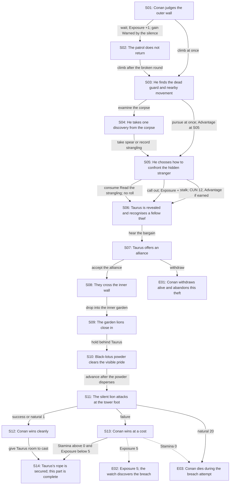

# *The Tower of the Elephant* Story Profile

## Scope

This profile applies the approved Authored S&S solo core to the first
paper-playable infiltration slice of *The Tower of the Elephant*. It fixes the
reader-facing resources, state, passage graph, tests, endings, and fidelity
limits for that slice. Authored passages state the stakes, resolve opposition,
apply consequences, and update state; there are no opponent rolls or repeated
combat rounds.

Revised 7 September 2026 after an external editorial pass. The changes from
the 31 July version are: the wait at `S01` and the immediate pursuit at `S03`
each earn Advantage on the `S05` stalk, so neither is a dominated choice; and
Exposure is read only where it can change or where the fiction acknowledges
it, instead of in every passage. Barry's decision on 20 September 2026 kept
death on a natural 20 for every lion method: "it captures the sometimes
merciless brutality of this world (and players can always replay!)".

## Conan

The reader plays the young but already seasoned Conan depicted in the source:

`BRN 13 | AGI 12 | CUN 12 | WIL 12 | FOR 10/10 | STM 6/6`

The profile has the approved 20-point *Sinew & Steel* provenance:

- Iron & Ruin pulp starting budget: 12 build points;
- four prior milestones: 8 build points; and
- total: 20 build points.

| Score | Increase from baseline | Cost |
| --- | ---: | ---: |
| Brawn 13 | +3 | 6 |
| Agility 12 | +2 | 4 |
| Cunning 12 | +2 | 4 |
| Will 12 | +2 | 4 |
| Fortune 10 | +0 | 0 |
| Stamina 6 | +1 | 2 |
| **Total** |  | **20** |

The four milestones abstract decisive development through Conan's Cimmerian
upbringing and early adventures. They need not correspond one-to-one with four
complete stories.

*Sinew & Steel* now prices a tag (Advantage when one named niche squarely
fits) at 2 build points. Conan carries no tag in this slice: every Advantage
here is printed by the passage, so a reader-adjudicated niche would add a
rule without adding a decision. A tag such as *Cimmerian climber* is a live
candidate for the ascent slice, funded by dropping Will to 11.

For a consequential test, roll one d20 and succeed when the chosen result is
equal to or below the named attribute. With Advantage, roll two d20s and keep
the lower result. The passage captures the attribute target when the roll is
made and states the stakes first. After seeing an ordinary result, the reader
may spend one Fortune per point used to lower the chosen die. A natural 1 and
a natural 20 are locked and cannot be changed with Fortune.

## Lethality

The slice uses fiction-first lethality between mixed consequences and hard
pulp. A passage states mortal stakes before a consequential roll. An ordinary
failure may cause authored Stamina loss, Exposure, or lost position; a
credibly fatal result goes directly to `E03`. There is no universal rescue
rule.

One Stamina is an ordinary injury and two Stamina is a serious injury. If an
authored damaging result reduces Conan to 0 Stamina, go to `E03` immediately.

A locked natural 20 against a mortal hazard is death, whatever method Conan
chose. The passage says so before the choice.

## Exposure

`Exposure` is visible evidence, delay, or disturbance that makes the intrusion
more likely to be discovered. It starts at 0 and is capped at 5.

| Exposure | Fictional state | Passage effect |
| ---: | --- | --- |
| 0-2 | The intruders remain unconfirmed. | No passage in this slice reads the value. |
| 3-4 | The watch has begun to look for its missing man. | `S10` and `S14` acknowledge the search in prose; the state carries into the next slice. |
| 5 | The breach is discovered. | Resolve the contextual `E02` crisis; do not reduce the track to preserve the route. |

Exposure increases only for these events in the slice:

- `+1` when Conan waits through another patrol interval at `S01`;
- `+1` when he calls out to the hidden stranger at `S05`;
- `+1` for an ordinary failed stalk at `S05`, or `+2` for a natural 20 there;
  and
- the amount printed by the selected lion method on a failure or natural 20
  at `S11`.

The maximum Exposure entering `S11` is 3, so `E02` is reachable only through
the lion exchange. Exposure checks are therefore printed at `S13` and nowhere
else. No ordinary event lowers Exposure in this slice. The source already
supplies the whole-story release: Yag-kosha's final act stills the soldiers
and clears Conan's escape. The exact full-adventure passage for that release
remains deferred.

## Recovery

The slice provides no Stamina or Fortune recovery. Lines 72-188 are one
continuous trespass through active danger; observation at the wall and waiting
for the black-lotus cloud to disperse provide neither treatment nor safety.
Current values remain capped at their printed maxima.

## Slice boundary

The slice begins outside the outer wall at source line 72. It includes the
final outer-wall beat of `TT-04` and all events mapped as `TT-05` through
`TT-08`. It ends after the silent lion when Taurus's rope is ready for the
ascent at source line 188.

## Sparse state

The slice starts with:

```text
Sword
Fortune 10/10
Stamina 6/6
Exposure 0/5
```

| State | Kind | Producer | Consumer |
| --- | --- | --- | --- |
| `Warned by the silence` | Story mark | Wait through the broken patrol round at `S02`. | Advantage on the `S05` stalk; cross it off when used. |
| `Guard's spear` | Possession | Take it from the corpse at `S04`. | Unlocks the spear method at `S11`; cross it off when used. |
| `Read the strangling` | Story mark | Study the corpse at `S04`. | Bypasses the `S05` standoff with quiet recognition; cross it off when used. |

`Guard's spear` and `Read the strangling` are mutually exclusive. Immediate
pursuit from `S03` also grants Advantage on the `S05` stalk, read directly
from the route rather than from a mark, because `S05` follows `S03` at one
remove. No other possession or story mark is recorded in this slice. Taurus's
rope and black-lotus powder remain his equipment and never enter Conan's
sheet.

## Passage graph



The exact transitions and conditions are:

```text
S01 -> S02: wait; Exposure +1; write Warned by the silence
S01 -> S03: climb at once
S02 -> S03: climb after the broken round
S03 -> S04: examine the corpse before following the movement
S03 -> S05: pursue at once; the S05 stalk is made with Advantage
S04 -> S05: take Guard's spear or record Read the strangling
S05 -> S06: consume Read the strangling; no roll
S05 -> S06: call out; Exposure +1
S05 -> S06: stalk; CUN 12; Advantage if Warned by the silence (consumed) or
            direct from S03
S06 -> S07: hear the bargain
S07 -> S08: accept the alliance
S07 -> E01: withdraw
S08 -> S09: drop into the inner garden
S09 -> S10: hold behind Taurus
S10 -> S11: advance after the powder disperses
S11 -> S12: success or natural 1 on any method
S11 -> S13: failure on any method
S11 -> E03: natural 20 on any method
S12 -> S14: give Taurus room to cast
S13 -> S14: continue if Stamina remains above 0 and Exposure below 5
S13 -> E02: Exposure has reached 5
S13 -> E03: Stamina has reached 0
```

### `S05`: standoff with Taurus

If Conan stalks the stranger, the target is `CUN 12`. The roll is made with
Advantage when Conan holds `Warned by the silence` (which is then crossed off)
or arrived directly from `S03`. Otherwise it is a standard roll.

- Success reaches `S06` without cost.
- Ordinary failure reaches `S06`, loses 1 Stamina, and adds 1 Exposure.
- A natural 1 reaches `S06` with Conan in the superior position.
- A natural 20 reaches `S06`, loses 2 Stamina, and adds 2 Exposure.
- Post-roll Fortune may alter an ordinary result but never a natural 1 or 20.

Exposure cannot reach 5 at `S05`, so the passage prints no crisis check.

### `S11`: the silent lion

The passage states before the choice that the lion is at killing range and
that a natural 20 on any method is death.

| Method | Availability | Roll | Success | Failure | Natural 1 | Natural 20 |
| --- | --- | --- | --- | --- | --- | --- |
| Brace the guard's spear | Requires and consumes `Guard's spear` | BRN 13 with Advantage | `S12` | lose 2 Stamina, Exposure +1, `S13` | `S12` | `E03` |
| Meet the leap with the sword | Always available | BRN 13 | `S12` | lose 2 Stamina, Exposure +1, `S13` | `S12` | `E03` |
| Slip aside and cut as it passes | Always available | AGI 12 | `S12` | lose 1 Stamina, Exposure +2, `S13` | `S12` | `E03` |

Post-roll Fortune may alter ordinary dice only. `S13` checks Stamina 0 and
Exposure 5 before continuing to `S14`. With full starting Stamina, no route in
this slice can reach 0 Stamina; the `S13` check exists so the printed rule
holds for a reader whose sheet says otherwise, and so the pattern is
established for later slices.

### Choice economy

Every branch in the slice trades something:

| Choice | Cost | Payoff |
| --- | --- | --- |
| Wait at `S01` | Exposure +1 | Advantage on the stalk |
| Pursue at `S03` | Forgo the corpse | Advantage on the stalk |
| Spear at `S04` | Forgo the strangling mark | Advantage on the lethal lion roll |
| Strangling at `S04` | Forgo the spear | Skip the stalk roll entirely |
| Call out at `S05` | Exposure +1 | No roll |
| Brawn lion methods | Higher Stamina cost on failure; spear needs the discovery | Lower Exposure cost; spear has Advantage |
| Agility lion method | Lower target; higher Exposure cost | Lower Stamina cost on failure |

The spear remains the strongest single discovery because it protects the only
roll that can kill. That is intended: it rewards reading the body over rushing
the mover, and it costs the reader the quiet recognition of Taurus.

## Canonical route and earned alternatives

The canonical route is:

```text
S01 -> S03 -> S04 -> S05 -> S06 -> S07 -> S08 -> S09 -> S10
-> S11 -> S12 -> S14
```

Every route through `S14` is stateful: the reader arrives with a different
Fortune, Stamina, and Exposure history, and possibly with an unconsumed mark.
`E01` is a credible refusal ending in which Conan survives but abandons the
theft. `E02` and `E03` enforce external and mortal consequences respectively.

## Source-fidelity constraints

- Conan can be cautious, suspicious, curious, proud, violent, compassionate,
  and practical; he cannot become a timid modern moral commentator.
- Taurus remains formidable, confident, and more prepared than Conan.
- The black lotus, visible lions, lone silent lion, rope, hook, and tower
  remain source-grounded facts.
- The slice may alter Conan's method and cost; it may not remove Taurus,
  relocate the tower, turn the lions into routine opponents, or reveal
  Yag-kosha early.
- Howard's own lion kill is the sword stroke that splits the skull. The
  sword method reproduces it; the spear and the evasion are elastic
  alternatives.

## Deferred decisions

- Upper-tower passage design, including whether Conan gains a climbing tag.
- Consolidating single-exit passages (`S08`-`S10`) once the passage numbering
  no longer anchors calibration records and harness tests.
- Full-adventure state.
- Machine-readable representation.
- Validators.
- Deterministic harness.
- AI facilitator.
