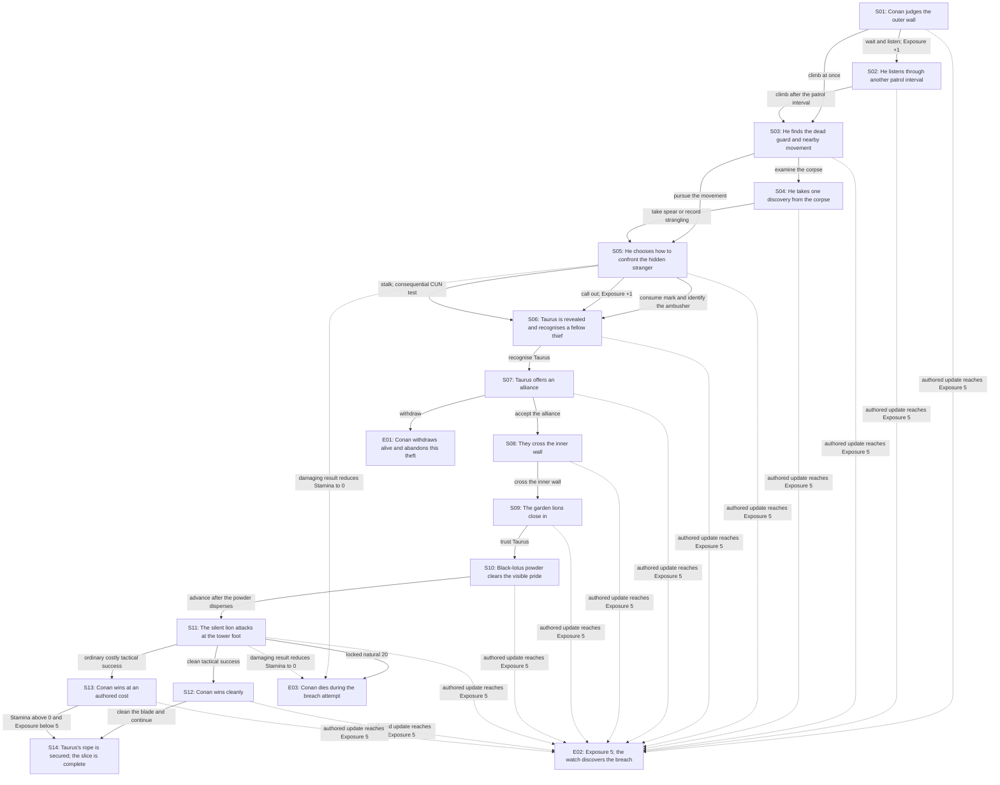

# *The Tower of the Elephant* Story Profile

## Scope

This profile applies the approved Authored S&S solo core to the first
paper-playable infiltration slice of *The Tower of the Elephant*. It fixes the
reader-facing resources, state, passage graph, tests, endings, and fidelity
limits for that slice. Authored passages state the stakes, resolve opposition,
apply consequences, and update state; there are no opponent rolls or repeated
combat rounds.

## Conan

The reader plays the young but already seasoned Conan depicted in the source:

`BRN 13 | AGI 12 | CUN 12 | WIL 12 | FOR 10/10 | STM 6/6`

The profile has the approved 20-point *Sinew & Steel* provenance:

- Iron & Ruin pulp starting budget: 12 build points;
- four prior milestones: 8 build points; and
- total: 20 build points.

| Score | Increase from baseline | Cost |
| --- | ---: | ---: |
| Brawn 13 | +3 | 6 |
| Agility 12 | +2 | 4 |
| Cunning 12 | +2 | 4 |
| Will 12 | +2 | 4 |
| Fortune 10 | +0 | 0 |
| Stamina 6 | +1 | 2 |
| **Total** |  | **20** |

The four milestones abstract decisive development through Conan's Cimmerian
upbringing and early adventures. They need not correspond one-to-one with four
complete stories.

For a consequential test, roll one d20 and succeed when the chosen result is
equal to or below the named attribute. With Advantage, roll two d20s and keep
the lower result. The passage captures the attribute target when the roll is
made and states the stakes first. After seeing an ordinary result, the reader
may spend one Fortune per point used to lower the chosen die. A natural 1 and
a natural 20 are locked and cannot be changed with Fortune.

## Lethality

The slice uses fiction-first lethality between mixed consequences and hard
pulp. A passage states mortal stakes before a consequential roll. An ordinary
failure may cause authored Stamina loss, Exposure, or lost position; a
credibly fatal result goes directly to `E03`. There is no universal rescue
rule.

One Stamina is an ordinary injury and two Stamina is a serious injury in this
slice. If an authored damaging result reduces Conan to 0 Stamina, go to `E03`
immediately.

## Exposure

`Exposure` is visible evidence, delay, or disturbance that makes the intrusion
more likely to be discovered. It starts at 0 and is capped at 5.

| Exposure | Fictional state | Passage effect |
| ---: | --- | --- |
| 0-2 | The intruders remain unconfirmed. | All listed choices remain available. |
| 3 | The watch has reason for unease. | Passages acknowledge movement or attention below; each passage states any restriction it applies. |
| 4 | A search is beginning. | Later passages become more urgent; each passage states any restriction it applies. |
| 5 | The breach is discovered. | Resolve the contextual `E02` crisis; do not reduce the track to preserve the route. |

Exposure increases only for these events in the slice:

- `+1` when Conan deliberately waits through another patrol interval;
- `+1` when he calls loudly or creates an avoidable disturbance;
- `+1` for an ordinary failed standoff with Taurus;
- `+2` for a natural 20 during that standoff; and
- the amount printed by the selected lion tactic on a costly result.

No ordinary event lowers Exposure in this slice. The source already supplies
the whole-story release: Yag-kosha's final act stills the soldiers and clears
Conan's escape. The exact full-adventure passage for that release remains
deferred.

## Recovery

The slice provides no Stamina or Fortune recovery. Lines 72-188 are one
continuous trespass through active danger; observation at the wall and waiting
for the black-lotus cloud to disperse provide neither treatment nor safety.
Current values remain capped at their printed maxima.

Exposure has no ordinary reduction here. Its whole-story release is the
source-grounded event recorded above, outside this slice.

## Slice boundary

The slice begins outside the outer wall at source line 72. It includes the
final outer-wall beat of `TT-04` and all events mapped as `TT-05` through
`TT-08`. It ends after the silent lion when Taurus's rope is ready for the
ascent at source line 188.

## Sparse state

The slice starts with:

```text
Sword
Fortune 10/10
Stamina 6/6
Exposure 0/5
```

At `S04`, Conan records exactly one of two mutually exclusive discoveries:

| State | Kind | Producer | Consumer |
| --- | --- | --- | --- |
| `Guard's spear` | Possession | Take it from the corpse at `S04`. | Unlocks the spear method at `S11`; cross it off when used. |
| `Read the strangling` | Story mark | Study the corpse at `S04`. | Unlocks the quiet recognition choice at `S05`; cross it off when used. |

If Conan goes directly from `S03` to `S05`, he records neither discovery. No
other possession or story mark is recorded in this slice. Taurus's rope and
black-lotus powder remain his equipment and never enter Conan's sheet.

## Passage graph



## Passage blueprint

| ID | Purpose |
| --- | --- |
| `S01` | Conan judges the outer wall |
| `S02` | He listens through another patrol interval |
| `S03` | He finds the dead guard and nearby movement |
| `S04` | He takes one discovery from the corpse |
| `S05` | He chooses how to confront the hidden stranger |
| `S06` | Taurus is revealed and recognises a fellow thief |
| `S07` | Taurus offers an alliance |
| `S08` | They cross the inner wall |
| `S09` | The garden lions close in |
| `S10` | Black-lotus powder clears the visible pride |
| `S11` | The silent lion attacks at the tower foot |
| `S12` | Conan wins cleanly |
| `S13` | Conan wins at an authored cost |
| `S14` | Taurus's rope is secured; the slice is complete |
| `E01` | Conan withdraws alive and abandons this theft |
| `E02` | Exposure 5: the watch discovers the breach |
| `E03` | Conan dies during the breach attempt |

The exact transitions and conditions are:

```text
S01 -> S02: wait and listen; Exposure +1
S01 -> S03: climb at once
S02 -> S03: climb after the patrol interval
S03 -> S04: examine the corpse before following the movement
S03 -> S05: pursue the movement immediately
S04 -> S05: take Guard's spear or record Read the strangling
S05 -> S06: consume Read the strangling and identify a human ambusher
S05 -> S06: call out without the mark; Exposure +1
S05 -> S06: stalk the stranger; consequential CUN test
S06 -> S07: recognise Taurus
S07 -> S08: accept the alliance
S07 -> E01: withdraw
S08 -> S09: cross the inner wall
S09 -> S10: trust Taurus's instruction
S10 -> S11: advance after the powder disperses
S11 -> S12: clean tactical success
S11 -> S13: ordinary costly tactical success
S11 -> E03: locked natural 20
S12 -> S14: clean the blade and continue
S13 -> S14: continue if Stamina remains above 0 and Exposure below 5
any non-terminal node -> E02: an authored update reaches Exposure 5
any damaging result -> E03: Stamina reaches 0
```

### `S05`: standoff with Taurus

If Conan stalks the stranger, capture the target at `CUN 12` and state the
stakes before rolling: a clean approach reaches the stranger without cost,
while a mistake lets the stranger seize position, injure Conan, and make the
intrusion easier to discover.

- Success reaches `S06` without cost.
- Ordinary failure reaches `S06`, loses 1 Stamina, and adds 1 Exposure.
- A natural 1 reaches `S06`, with prose showing Conan takes the superior
  position.
- A natural 20 reaches `S06`, loses 2 Stamina, and adds 2 Exposure.
- Post-roll Fortune may alter an ordinary result but never a natural 1 or 20.

### `S11`: the silent lion

State this fatal stake before the player chooses a method: the lion attacks
without sound, at killing range, and a natural 20 sends Conan directly to `E03`,
regardless of method.

| Method | Availability | Roll | Clean success | Ordinary failure | Natural 1 | Natural 20 |
| --- | --- | --- | --- | --- | --- | --- |
| Brace the guard's spear | Requires and consumes `Guard's spear` | BRN 13 with Advantage | `S12` | lose 2 Stamina, Exposure +1, then `S13` | kill before it can make a sound, then `S12` | `E03` |
| Wheel beneath the leap | Always available | BRN 13 | `S12` | lose 2 Stamina, Exposure +1, then `S13` | split the skull cleanly, then `S12` | `E03` |
| Slip aside and cut as it passes | Always available | AGI 12 | `S12` | lose 1 Stamina, Exposure +2, then `S13` | turn its own speed against it, then `S12` | `E03` |

Post-roll Fortune may alter ordinary dice only. Apply the printed Stamina and
Exposure costs before leaving `S11`. If Stamina reaches 0, resolve `E03`; if
Exposure reaches 5, resolve the contextual `E02` crisis. Continue through
`S13` only while Stamina remains above 0 and Exposure below 5.

## Canonical route and earned alternatives

The canonical route is:

```text
S01 -> S03 -> S04 -> S05 -> S06 -> S07 -> S08 -> S09 -> S10
-> S11 -> S12 -> S14
```

Both the `Guard's spear` and `Read the strangling` routes may reach `S14`.
Their different options and resource histories make the reconvergence
stateful: the spear changes the lion tactic and is consumed there, while the
strangling mark changes the approach to Taurus and is consumed there.

`E01` is a credible refusal ending in which Conan survives but abandons the
theft. `E02` and `E03` enforce external and mortal consequences respectively.

## Source-fidelity constraints

- Conan can be cautious, suspicious, curious, proud, violent, compassionate,
  and practical; he cannot become a timid modern moral commentator.
- Taurus remains formidable, confident, and more prepared than Conan.
- The black lotus, visible lions, lone silent lion, rope, hook, and tower
  remain source-grounded facts.
- The slice may alter Conan's method and cost; it may not remove Taurus,
  relocate the tower, turn the lions into routine opponents, or reveal
  Yag-kosha early.

## Deferred decisions

- Upper-tower passage design.
- Full-adventure state.
- Machine-readable representation.
- Validators.
- Deterministic harness.
- AI facilitator.
